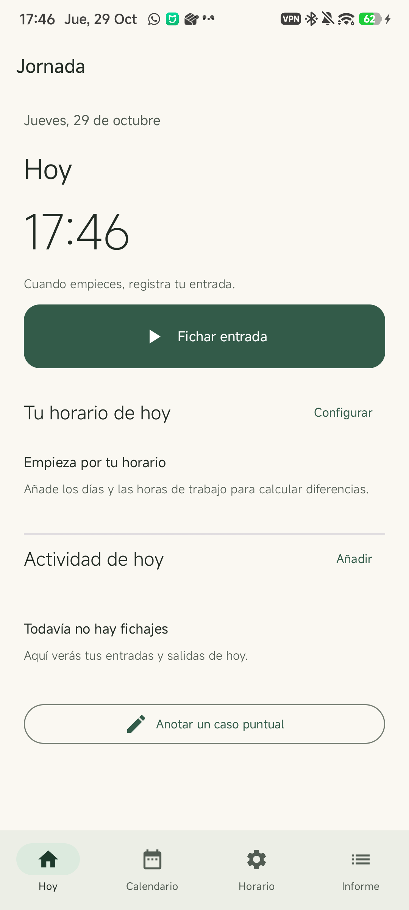
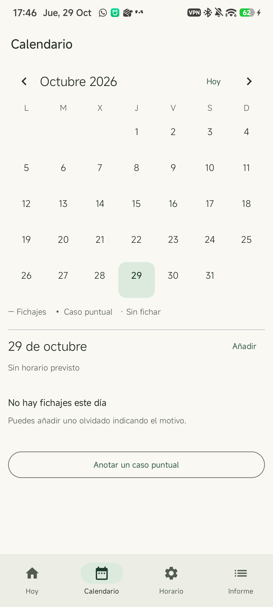
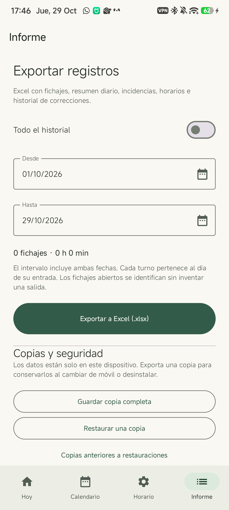

# Jornada

Aplicación Android para registrar entradas y salidas del trabajo en el propio dispositivo. Interfaz en castellano, Kotlin y Jetpack Compose Material 3.

## Instalar

Descarga `Jornada-1.0.0.apk` desde [la última versión](https://github.com/PabloValencia14/Jornada/releases/latest) y ábrelo en Android. Si Android lo solicita, autoriza la instalación desde la aplicación con la que hayas descargado el archivo. Requiere Android 8.0 o posterior (API 26).

No requiere cuenta, servidor ni conexión. No solicita permisos de Internet, ubicación, contactos o acceso general al almacenamiento. No utiliza publicidad, analítica, alarmas ni servicios en segundo plano.

<p>
  
  
  
</p>

## Funciones

- **Hoy:** entrada y salida en un toque; varios tramos diarios y estado de la jornada abierta.
- **Horario:** días de trabajo, hasta tres tramos por día, jornada partida y turnos nocturnos. Cada horario tiene fecha de vigencia; los anteriores se conservan.
- **Calendario:** entradas, salidas, horas trabajadas, retrasos de entrada, salidas anticipadas y posteriores, y tramos sin fichajes.
- **Casos puntuales:** justificaciones, vacaciones, festivos, baja, permiso u observaciones. Una justificación conserva las horas reales y explica la diferencia; un día exento deja de tener horas previstas.
- **Correcciones:** altas manuales, edición y anulación con motivo obligatorio. Los valores anteriores quedan en el historial. Los registros anulados se pueden recuperar desde el calendario.
- **Excel real `.xlsx`:** todas las fechas o un intervalo inclusivo. Incluye fichajes, resumen diario, incidencias, horarios e historial de cambios de los registros seleccionados. Los minutos son valores numéricos; los textos se guardan como texto, sin ejecutar fórmulas.
- **Copias JSON:** exportación y restauración completa. Antes de restaurar se guarda automáticamente una copia del estado anterior en el almacenamiento privado; se puede exportar desde Informe.
- Tema claro y oscuro según el sistema; navegación inferior en móvil y lateral en tablet.

## Uso

1. En **Horario**, añade tu horario e indica desde cuándo está vigente. Deja vacíos los días libres. Ejemplo: `08:00-15:00`; jornada partida: `08:00-13:00, 16:00-19:00`.
2. En **Hoy**, pulsa **Fichar entrada** al empezar y **Fichar salida** al terminar. Para una pausa no trabajada, registra salida y una nueva entrada al volver.
3. En **Calendario**, selecciona un día para consultar o corregir sus fichajes y anotar un caso puntual.
4. En **Informe**, elige las fechas y pulsa **Exportar a Excel**. El selector de Android permite decidir dónde guardar el archivo.
5. Guarda una copia completa periódicamente y antes de cambiar de dispositivo o desinstalar.

## Criterios de cálculo

- Los fichajes se guardan como instantes y conservan la zona horaria de su entrada. La duración real tiene en cuenta los cambios de hora.
- Un turno nocturno pertenece al **día de la entrada**, también al filtrar y exportar. Una salida igual a la hora de entrada no define un turno de 24 horas válido.
- El horario previsto utiliza horas de reloj. Durante un cambio de hora, la duración real puede diferir de las horas previstas.
- Los tramos de un día se agrupan por proximidad a los intervalos previstos. Para cada tramo, se compara la primera entrada y la última salida. Las pausas internas descuentan trabajo; no se cuentan como nuevas llegadas tarde.
- La tolerancia se aplica al total diario de cada clase de diferencia. No modifica las marcas ni los minutos calculados.
- Una salida posterior al horario se muestra como diferencia horaria; la app no determina su autorización o compensación.
- Un fichaje abierto no tiene una salida inventada: muestra el tiempo transcurrido en pantalla y figura como abierto en el Excel.
- Las correcciones conservan los segundos originales si solo se cambia la nota. Al introducir una hora manual durante un cambio de hora, se rechazan horas inexistentes o ambiguas.
- No se aceptan fichajes solapados ni dos entradas abiertas simultáneas. El intervalo de exportación máximo es de 100 años.
- Corregir un horario existente recalcula los días cubiertos por él y deja rastro en el historial. Para un cambio real de horario, añade una nueva vigencia.

El reloj del dispositivo es la fuente de las marcas. El historial facilita revisar correcciones, pero no es una prueba criptográfica ni impide que quien controla el dispositivo altere sus datos.

## Datos y privacidad

SQLite privado, transacciones para cada modificación y ninguna transmisión realizada por la aplicación. La copia automática de Android y la transferencia automática entre dispositivos están excluidas: utiliza las copias de Informe. Los archivos exportados contienen tus registros en texto legible; guárdalos en un lugar adecuado. Si eliges un proveedor de almacenamiento en la nube en el selector del sistema, ese proveedor gestiona el archivo elegido.

Desinstalar la aplicación o borrar su almacenamiento elimina los registros internos, incluidas las copias anteriores a una restauración. Los archivos que hayas exportado fuera de la app permanecen.

## Compilar

JDK 17, Android SDK 35 y Android Studio o las herramientas de línea de comandos. No requiere claves ni cuentas para compilar la variante de desarrollo.

```sh
./gradlew testDebugUnitTest assembleDebug lintDebug
```

En Windows, utiliza `gradlew.bat`. El APK se genera en `app/build/outputs/apk/debug/`. La variante de desarrollo usa `dev.jornada.debug`, separada de la versión publicada `dev.jornada`.

Para firmar tu propia versión, crea un archivo **no versionado** `signing.properties` en la raíz:

```properties
storeFile=/ruta/privada/jornada-release.jks
storePassword=TU_CLAVE
keyAlias=jornada
keyPassword=TU_CLAVE
```

```sh
./gradlew assembleRelease lintRelease
```

Conserva la clave privada y las contraseñas fuera del repositorio. Una APK firmada con otra clave no puede actualizar la distribución publicada. Sin `signing.properties`, Gradle genera la versión release sin firmar.

## Pruebas

Pruebas unitarias de jornadas partidas y nocturnas, cambio de hora, vigencias, tolerancia, incidencias, solapamientos, preservación de segundos y estructura de Excel. El archivo Excel de prueba se valida además con un lector independiente; no se utiliza una biblioteca de hojas de cálculo dentro del APK.

El test de integración Android comprueba persistencia SQLite, historial, validación de copias, rechazo de entradas simultáneas y restauración con copia previa. **Borra únicamente los datos de la variante `dev.jornada.debug`; no lo ejecutes sobre registros que quieras conservar en esa variante.**

```sh
./gradlew assembleDebug assembleDebugAndroidTest
adb -s SERIAL install -r app/build/outputs/apk/debug/app-debug.apk
adb -s SERIAL install -r app/build/outputs/apk/androidTest/debug/app-debug-androidTest.apk
adb -s SERIAL shell am instrument -w dev.jornada.debug.test/dev.jornada.SmokeTest
```

Consulta [la validación de la versión](docs/VALIDATION.md). [Licencia MIT](LICENSE).
